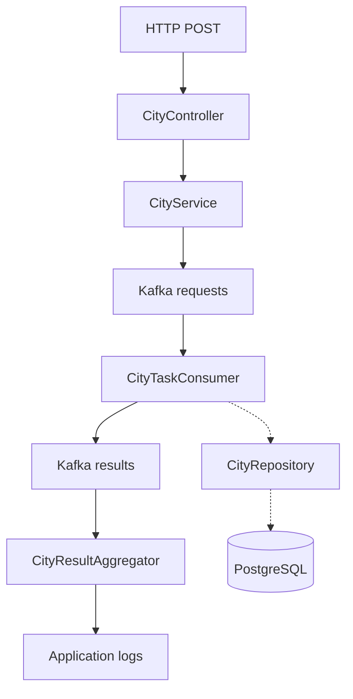

# City Population Service

**An event-driven Spring Boot backend demonstrating Kafka-based fan-out/fan-in processing, request correlation, and asynchronous result aggregation.**

This project uses a deliberately simple dataset—city populations—to explore backend architecture and messaging patterns. An HTTP request for a country is broken into city-level tasks, distributed through Apache Kafka, processed against PostgreSQL, and aggregated using a shared correlation ID.

> **Project status:** Functional, single-application demonstration. The fan-in result is currently printed in the Spring Boot logs. It is **not yet returned by an HTTP endpoint**. The project is intended to demonstrate Kafka messaging patterns, not to serve as a production-ready population data API.

## Features

- REST endpoints built with Spring Boot and Spring MVC.
- Layered **Controller → Service → Repository** architecture using constructor injection.
- PostgreSQL access through Spring JDBC (`JdbcTemplate`).
- Kafka producer/consumer flow with separate request and result topics.
- Fan-out from one country-level request into multiple city-level tasks.
- UUID correlation IDs for associating results with their originating request.
- Fan-in aggregation using `ConcurrentHashMap`, per-request synchronization, and duplicate-city protection.
- Local Kafka broker running in Docker.

## Architecture

The diagram uses short labels to remain readable on narrow screens. The full Kafka topic names are `city-population-requests` and `city-population-results`.



**How it works:** `CityService` first asks `CityRepository` for the country's cities and registers the correlation ID and expected result count with `CityResultAggregator`. It then publishes **one request message per city** to the request topic (fan-out). `CityTaskConsumer` queries PostgreSQL through `CityRepository` and publishes one result message per city to the result topic. `CityResultAggregator` collects and deduplicates messages with the same correlation ID, then prints the completed result (fan-in). The dashed arrows show database access by the worker.

All Spring components currently run in **one application instance**. Kafka is a separate broker in Docker; the system does not yet demonstrate independently deployed worker services or verified parallel consumer execution.

### Example message flow

A request for Canada discovers five cities in the sample database and publishes one request message per city:

```text
POST /countries/Canada/population-requests

Request topic (city-population-requests):
<correlation-id>,Canada,Calgary
<correlation-id>,Canada,Montreal
<correlation-id>,Canada,Ottawa
<correlation-id>,Canada,Toronto
<correlation-id>,Canada,Vancouver

Result topic (city-population-results):
<correlation-id>,Calgary,1306784
<correlation-id>,Montreal,1762949
<correlation-id>,Ottawa,1017449
<correlation-id>,Toronto,2794356
<correlation-id>,Vancouver,662248
```

The aggregator collects results by correlation ID and prints the completed map:

```text
Fan-in completed: {Calgary=1306784, Montreal=1762949, Ottawa=1017449, Toronto=2794356, Vancouver=662248}
```

Message payloads currently use comma-separated strings. Structured JSON messages would be a useful future improvement.

## Tech stack

| Layer | Technology |
| --- | --- |
| Language | Java 27 |
| Application framework | Spring Boot 4.1.1 / Spring MVC |
| Messaging | Apache Kafka / Spring Kafka |
| Database | PostgreSQL / Spring JDBC |
| Local infrastructure | Docker Desktop (Kafka broker) |
| Build | Maven (Maven Wrapper included) |

## Run locally

### Prerequisites

- JDK **27**.
- Docker Desktop with the Docker Engine running.
- PostgreSQL running locally on port **5432**.
- Git and an IDE such as IntelliJ IDEA (optional; Maven Wrapper is included).

### 1. Clone the repository

```bash
git clone https://github.com/vitowang1998/city-population-service.git
cd city-population-service
```

Access is required if the repository is private.

### 2. Set up PostgreSQL

Create a database named `city_population_db`. With pgAdmin or `psql`, execute the scripts in this order:

1. `database/schema.sql` — creates the `city_population` table.
2. `database/seed.sql` — inserts or updates 15 **official historical population figures** (five cities each in Canada, France, and USA) and deletes the previous China/Japan sample rows. It is safe to rerun for this demo dataset.

Population figures use **city proper / municipality boundaries**, not metro areas. They come from different official reference years and are not live data:

| Country | Reference year | Definition | Official source |
| --- | --- | --- | --- |
| Canada | 2021 Census | Municipality (census subdivision) | [Statistics Canada](https://www12.statcan.gc.ca/census-recensement/2021/as-sa/98-200-x/2021001/98-200-x2021001-eng.pdf) |
| France | 2023 | Commune, municipal population | [INSEE](https://www.insee.fr/fr/statistiques/1405599?geo=COM-75056+COM-13055+COM-69123+COM-31555+COM-06088) |
| USA | July 1, 2024 estimates | Incorporated city | [U.S. Census Bureau](https://www.census.gov/newsroom/press-releases/2025/vintage-2024-popest.html) |

The sample includes:

| Country | Cities |
| --- | --- |
| Canada | Toronto, Ottawa, Montreal, Vancouver, Calgary |
| France | Paris, Marseille, Lyon, Toulouse, Nice |
| USA | New York, Los Angeles, Chicago, Houston, Phoenix |

If you previously ran the older seed file, rerun `database/seed.sql` against `city_population_db` to remove the earlier China/Japan rows and add the new cities. Existing Canada rows are updated if needed.

The app uses the following connection settings in `src/main/resources/application.properties`:

```properties
spring.datasource.url=jdbc:postgresql://localhost:5432/city_population_db
spring.datasource.username=postgres
spring.datasource.password=${DB_PASSWORD}
```

Set `DB_PASSWORD` in your environment or your IntelliJ Run Configuration. **Do not commit database credentials.** Adjust the database URL or username if your local installation differs.

### 3. Start Kafka

Create and start a local Kafka broker:

```powershell
docker run -d --name city-kafka -p 9092:9092 apache/kafka:4.3.1
```

If `city-kafka` already exists but is stopped, use `docker start city-kafka` instead of running `docker run` again.

Create both Kafka topics (PowerShell or another terminal):

```powershell
docker exec city-kafka /opt/kafka/bin/kafka-topics.sh --bootstrap-server localhost:9092 --create --if-not-exists --topic city-population-requests --partitions 3 --replication-factor 1

docker exec city-kafka /opt/kafka/bin/kafka-topics.sh --bootstrap-server localhost:9092 --create --if-not-exists --topic city-population-results --partitions 3 --replication-factor 1
```

Verify that both topics exist:

```powershell
docker exec city-kafka /opt/kafka/bin/kafka-topics.sh --bootstrap-server localhost:9092 --list
```

This local setup runs a **single broker** with replication factor 1, so it does not provide broker-level fault tolerance.

### 4. Start Spring Boot

Import `pom.xml` into IntelliJ, configure JDK 27 and `DB_PASSWORD`, and run `CityPopulationServiceApplication`.

Alternatively, from PowerShell with the environment variable already set:

```powershell
.\mvnw.cmd spring-boot:run
```

The application listens on `localhost:8080` by default.

## API

### Get one city's population

```http
GET /cities/Canada/Toronto/population
```

Example response (`200 OK`):

```text
2794356
```

### Submit a country-level fan-out request

```http
POST /countries/Canada/population-requests
```

Example using PowerShell:

```powershell
curl.exe -i -X POST http://localhost:8080/countries/Canada/population-requests
```

Example response (`202 Accepted`):

```text
RequestId =  <generated-uuid>
```

The server generates a correlation ID, registers the expected number of city results, and publishes individual city tasks. **`202 Accepted` means tasks were submitted; it does not mean processing has completed.**

Watch the Spring Boot console for individual worker messages and the final aggregation:

```text
Sending result of correlationId = ... - Calgary population = 1306784 to result topic
Sending result of correlationId = ... - Montreal population = 1762949 to result topic
Sending result of correlationId = ... - Ottawa population = 1017449 to result topic
Sending result of correlationId = ... - Toronto population = 2794356 to result topic
Sending result of correlationId = ... - Vancouver population = 662248 to result topic
Fan-in completed: {Calgary=1306784, Montreal=1762949, Ottawa=1017449, Toronto=2794356, Vancouver=662248}
```

To try the other sample countries, use `POST /countries/France/population-requests` or `POST /countries/USA/population-requests`. Each country fans out into five city-level tasks. The order of messages and printed results is not guaranteed.

You can also inspect the result topic with:

```powershell
docker exec -it city-kafka /opt/kafka/bin/kafka-console-consumer.sh --bootstrap-server localhost:9092 --topic city-population-results
```

### Existing endpoint behavior

The country-level endpoint **does not** currently return the aggregated JSON result or expose a status-check API. Its purpose is to trigger the Kafka pipeline and return a correlation ID. The final aggregation is observable in the application's logs.

## Design decisions and trade-offs

**Why Kafka?** Kafka makes message distribution, consumer groups, partitions, and asynchronous aggregation visible in a concrete exercise. For this particular dataset—all records residing in one PostgreSQL table—a single SQL query would be simpler and generally more efficient. The Kafka architecture is intentional for learning and demonstration.

**Why correlation IDs?** Multiple country requests may overlap. A UUID distinguishes each fan-out batch so that results are collected against the correct request.

**How does fan-in know when it is done?** The service registers the expected city count before publishing messages. The aggregator groups results by correlation ID, deduplicates results by city name, and completes when it has received the expected number of distinct cities.

---

*Built as a hands-on backend engineering exercise exploring Spring Boot, PostgreSQL, Apache Kafka, and event-driven system design.*
